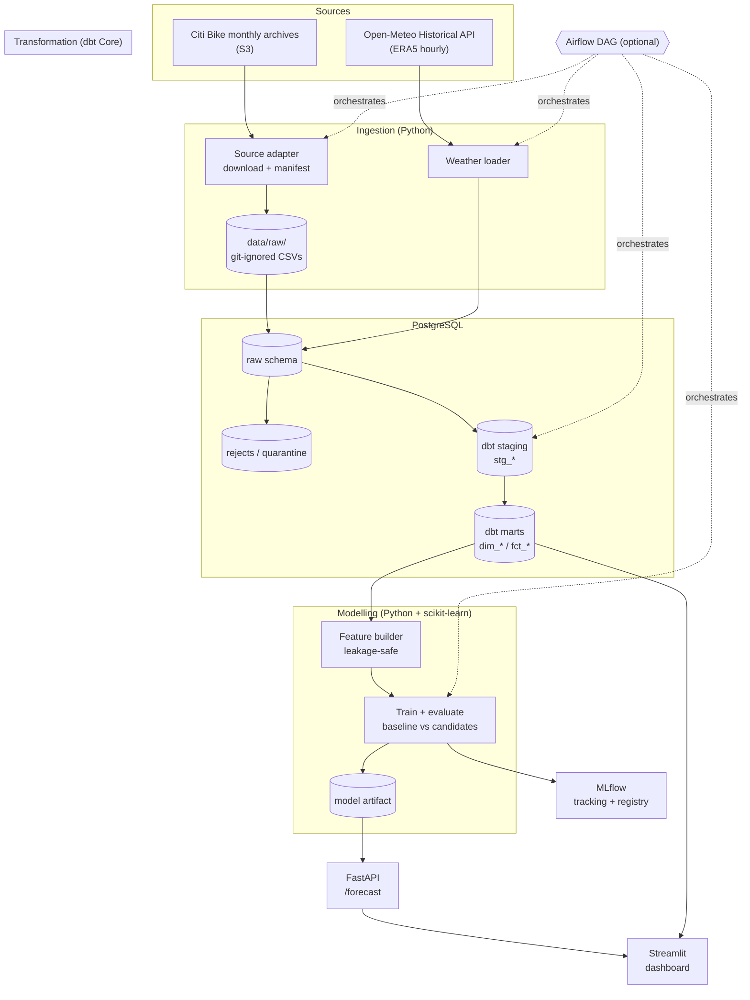

# Architecture

> Living design document. Ingestion (Phase 3) and the dbt transformation layer
> (Phases 4A–4B: demand, coverage, descriptive analytics) are implemented; their
> sections below describe the built system (`docs/phase-3-verification.md`,
> `docs/phase-4a-verification.md`, `docs/phase-4b-verification.md` hold the evidence).
> Sections for weather, features, modelling, serving, and orchestration remain design
> intent. Tool classifications: **Essential** (minimum viable), **Useful** (after the
> core works), **Optional** (only if time permits).

## 1. Design principles

- **Modular monolith, not microservices.** One repository, one process group, clear module
  boundaries. No service is split out without a demonstrated need.
- **Layered data flow.** Raw → staging → marts. Each layer has one job and is testable.
- **Idempotent by default.** Every stage can be re-run without duplicating or corrupting data.
- **Local-first reproducibility.** Docker Compose brings up the full stack on one machine.
- **Analytics and forecasting stay separate** (see `project-specification.md` §5).
- **Introduce tools only to solve a demonstrated problem.** Orchestration is added *after*
  the manual pipeline works.

## 2. Stack and classification

| Tool | Layer | Classification | Responsibility | Why include |
|---|---|---|---|---|
| Python + Pandas | Ingestion / feature engineering | **Essential** | Month-by-month stream, parse, clean, aggregate | Core language; low memory |
| **pyarrow/Parquet** | Landing format | **Essential** | Parquet per month (partitioned) | Efficient, avoids keeping all raw CSV |
| PostgreSQL | Storage | **Essential** | Persistent marts + metadata | Relational; optionally conformed trips |
| dbt Core | Transformation / testing | **Essential** | Staging → marts SQL models, schema/data tests, docs | Analytical SQL |
| scikit-learn | Modelling | **Essential** | Baseline + candidate models, metrics, pipelines | CPU-only |
| Docker Compose | Environment | **Essential** | Reproducible local DB (+ MLflow later) | Local reproducibility |
| pytest | Testing | **Essential** | Unit + integration tests | Quality requirement |
| pydantic-settings + `.env` | Config | **Essential** | Typed config, no hardcoded secrets | Reproducibility/safety |
| Make | Task runner | **Essential** | Single entry points | Low-cost DX |
| Git + GitHub Actions | CI + workflow | **Essential** | Lint, typecheck, tests on push | CI requirement |
| MLflow | Experiment tracking | **Later** | Params/metrics/artifacts | After core pipeline/baseline |
| FastAPI | Serving | **Later** | `/forecast` endpoint | After training/eval |
| Streamlit | Dashboard | **Later** | History + forecast visualisation | After serving |
| Apache Airflow | Orchestration | **Optional / future** | DAG scheduling | Skip or add last; Make orchestrates |
| LightGBM / XGBoost | Modelling | **Optional** | Gradient-boosted candidate | CPU-only |
| statsmodels (SARIMA) | Modelling | **Optional** | Classical time-series candidate | Later if desired |

**Simplified sequence:** Core (ingest→validate→transform→features→train+baseline) first. **Later:** MLflow, FastAPI, Streamlit. Airflow, live feeds, cloud/GPU, microservices out.

## 3. Component responsibilities

1. **Source adapter (ingest)**
   - Parses the S3 ListObjectsV2 index (parse listing, don't hardcode names). Filters for
     NYC monthly archives (`YYYYMM-citibike-tripdata.zip`) in the configured window.
   - Month-by-month: downloads, records manifest (checksum, bytes, downloaded_at). Skips
     already-cached files.
   - Handles naming inconsistency (may be `…-tripdata.csv.zip` or `…-tripdata.zip`), and
     skips non-CSV members (`__MACOSX` etc.).

2. **Raw loader**
   - Streams each archive: open CSV members, apply basic tolerance (quoted/unquoted),
     types as text. Write landing to **Parquet per month** partitioned by `year/month`
     (git-ignored). 
   - Load conformed trip records into PostgreSQL `raw.trips` (text columns + `source_file`,
     `_ingested_at`). Use COPY/psycopg in batches. For large windows, consider keeping trips
     in Parquet and only marts in Postgres.

3. **Validation & cleaning (Python)**
   - Rules: required fields non-null, parseable, timestamps valid, duration ≥ 0 where
     computable, handle end-station nulls (do not blindly drop), dedupe by `ride_id`, handle
     fuzzy month boundaries. 
   - Rejects to `raw.trips_rejects` with `reason` (never silent drop). Produces conformed
     trips for staging.

4. **dbt — staging (`stg_*`)**
   - `stg_trips`: normalize types (to `timestamptz` after tz conversion), cast station IDs
     as text, compute `trip_duration_sec`, standardize columns. Deterministic.

5. **dbt — marts (`fct_*`, `dim_*`)**
   - `dim_stations`: station dimension (latest geometry). `fct_trips`: trip grain with
     FKs/attributes. `fct_hourly_demand`: hourly system-level trip starts; bucket by
     **America/New_York** local hour; materialize missing hours as 0; track coverage. 
   - `fct_hourly_demand_enriched`: LEFT JOIN weather (UTC-aligned). Data tests: grain,
     not-null, coverage, sanity checks.

6. **Weather module**
   - Open-Meteo Historical API `/v1/archive`. **Join on absolute time (UTC)** to avoid the
     observed DST offset bug: request `timezone=GMT` (or `timeformat=unixtime`) and convert
     to `America/New_York` using `zoneinfo`. Fetch hourly for city (40.7128, −74.0060).
   - Only variables up to prediction origin used for features (lagged). Store hourly weather
     in `raw.weather_hourly` and a dbt mart. License: verify before publishing derived data.

7. **Feature builder**
   - Build features from hourly mart using only information available at forecast time (≤ t).
     Lags, shift-then-rolling, calendar from local hour. Materialize `ml.features_hourly`
     with `feature_cutoff <= t - horizon` per row.

8. **Training / evaluation** (core)
   - Chronological split (train/val/test). Baseline: lag-24 (primary), lag-168 (secondary),
     hour-of-week mean optional. Metrics MAE (primary), RMSE. MLflow: params, metrics,
     artifacts (add when available).

9. **Serving (FastAPI)** — **later milestone** (after training)
10. **Dashboard (Streamlit)** — **later milestone** (after serving)
11. **Orchestration** — **Make by default**. Airflow optional/future only if truly needed.

## 4. Data flow

```
Public source (Citi Bike monthly archives)          Open-Meteo Historical API
            │                                                  │
            ▼                                                  ▼
   ┌──────────────────┐                              ┌──────────────────┐
   │ Source adapter   │  data/raw/ (git-ignored)     │ Weather module   │
   │ (download+cache) │                              │ (fetch hourly)   │
   └────────┬─────────┘                              └─────────┬────────┘
            ▼                                                  ▼
   ┌──────────────────┐                              ┌──────────────────┐
   │ Raw loader       │  Postgres: raw schema        │ Raw weather load │
   └────────┬─────────┘                              └─────────┬────────┘
            ▼                                                  │
   ┌──────────────────┐                                        │
   │ Validate/Clean   │  → rejects/quarantine table            │
   └────────┬─────────┘                                        │
            ▼                                                  ▼
   ┌──────────────────────── dbt Core (Postgres) ────────────────────────┐
   │  staging (stg_trips, stg_stations, stg_weather)                     │
   │      ▼                                                              │
   │  marts: dim_stations · fct_trips · fct_hourly_demand                │
   │         fct_hourly_demand_enriched (weather + calendar)             │
   └────────┬────────────────────────────────────────────────────────────┘
            ▼
   ┌──────────────────┐      ┌──────────────────┐     ┌──────────────────┐
   │ Feature builder  │─────▶│ Training/eval    │────▶│ MLflow tracking  │
   │ (leakage-safe)   │      │ baseline+models  │     │ + model registry │
   └──────────────────┘      └────────┬─────────┘     └──────────────────┘
                                      ▼
                             ┌──────────────────┐
                             │ Model artifact   │
                             └────────┬─────────┘
                                      ▼
                    ┌──────────────┐         ┌──────────────┐
                    │ FastAPI      │         │ Streamlit    │
                    │ /forecast    │◀───────▶│ dashboard    │
                    └──────────────┘         └──────────────┘

(Optional, last) Airflow DAG orchestrates: ingest → validate → dbt → features → train
```

## 5. Mermaid architecture diagram



## 6. Proposed data model (provisional)

Types are indicative PostgreSQL types. Final columns depend on inspecting the selected
dataset in Phase 2; treat names/structure as a design intent, not a frozen schema.

### 6.1 Raw / source level

- **`raw.trips`** — implemented (Phase 3). Landing trip rows with source text preserved
  (`started_at_raw`/`ended_at_raw`, naive local NY), geometry, `member_casual`,
  plus `source_member`, `source_file_key`, `_ingested_at`, `_partition_month`
  (`YYYY-MM`); rejects quarantined in `raw.trips_rejects` with reasons.
  - Key: `ride_id` (unique, non-null; cross-file duplicates rejected at ingestion).
    **[verified P3.4]** Loader UTC columns (`started_at_utc` etc.) remain NULL for the
    ingested archive; the dbt layer re-derives them (see §6.2).

- **`raw.weather_hourly`** — Open-Meteo hourly response normalized, aligned to UTC hours.
  - Key: `(city_id, hour_utc)`.

- **`ingest.manifest`** — one row per fetched file: `source, file_name, checksum,
  bytes, fetched_at, window_start, window_end, status` (implemented, Phase 3).

### 6.2 Staging

- **`staging.stg_trips`** — implemented (Phase 4A), materialized as a **view** so the
  1.8M-row trip table is not duplicated. One row per `ride_id`:
  `ride_id (text, PK), rideable_type, started_at_raw, started_at_local, started_at_utc,
  started_at_status, ended_at_raw, ended_at_local, ended_at_utc, ended_at_status,
  trip_duration_sec (int, nullable), start_station_id (text), start_station_name,
  end_station_id (text), end_station_name, start_lat, start_lng, end_lat, end_lng,
  member_casual, source_member, source_file_key, _ingested_at`.
  - Timestamp text is parsed explicitly (format + calendar validation) and interpreted
    as naive `America/New_York` wall time. Every timestamp carries a DST status
    (`valid` / `ambiguous` / `nonexistent` / `invalid`); `*_utc` is set only for
    `valid` values — ambiguous/nonexistent local times are never assigned an invented
    UTC instant. See `dbt/macros/ny_timestamps.sql` and `docs/phase-4a-verification.md` §2.
  - Station IDs are text (may include suffix `_`); blank values normalize to NULL
    without dropping trips. `member_casual` is preserved unfiltered.

- **`stg.stg_stations`** *(planned)* — station dimension source:
  `station_id (text), station_name, lat, lon` (latest observed geometry).

- **`stg.stg_weather`** *(planned)* — typed weather (joined on UTC): `hour_utc
  (timestamptz), hour_local_ny, temperature_c, humidity_pct, apparent_temp_c,
  precipitation_mm, cloud_cover_pct, wind_speed_kmh, weather_code`.

### 6.3 Analytics-ready marts

- **`marts.dim_stations`** *(planned)* — `station_id (PK), station_name, lat, lon,
  first_seen_at, last_seen_at`.

- **`marts.fct_trips`** *(planned)* — cleaned trip fact at trip grain; PK `ride_id`;
  FKs to `dim_stations` via start/end station IDs. Grain test: unique `ride_id`.

- **`marts.fct_hourly_demand`** — implemented (Phase 4A), materialized as a table.
  - Columns: `hour_utc (timestamptz, PK), hour_local_start, hour_local_date,
    hour_local, day_of_week_local, is_weekend_local, rides_total, rides_member,
    rides_casual, is_source_truncated`.
  - Grain: exactly one row per **UTC hour** over a var-driven source-coverage window
    (verified January 2026 window minus the documented 2026-01-25 outage). New York DST
    offsets are whole hours, so UTC hours map 1:1 to local hours including across
    transitions. Hours inside the outage window are **absent, not zero-filled**.
    Trips whose timestamps are ambiguous/nonexistent/invalid are excluded from
    aggregation and accounted for in reconciliation tests. `is_source_truncated` marks
    the final local day of an end-keyed archive window (right truncation).
  - Tests: PK unique + not null, calendar/alignment consistency, member+casual=total,
    and full raw→staging→mart reconciliation (see `dbt/tests/`).

- **`marts.fct_hourly_demand_enriched`** *(planned)* — `fct_hourly_demand` LEFT JOIN
  `stg_weather` on `hour_utc`, adding weather columns. Test: join coverage/freshness;
  explicit handling of missing weather (nullable + flag).

- **`marts.fct_hourly_coverage`** — implemented (Phase 4B), materialized as a table.
  - Columns: `hour_utc (PK), hour_local_start, hour_local_date, hour_local,
    day_of_week_local, is_weekend_local, coverage_status, coverage_reason,
    observed_trips, demand_rides_total, in_demand_mart, first_trip_started_at,
    is_source_truncated`.
  - Grain: exactly one row per hour of the **full** var-driven window (744 for
    January 2026) — including outage hours the demand mart excludes. `observed_trips`
    is the literal source count; `demand_rides_total` is NULL (never zero-filled) for
    hours outside the demand mart. `coverage_status ∈ {complete, boundary, partial,
    unavailable}`; `partial` marks uncertain coverage (gap onset excluded from demand,
    gap resume retained but flagged). This model is the authority for "can this hour
    be trusted as real demand" — forecasting features must join against it.
  - Tests: status/reason/mart-membership invariants, full-join consistency with
    `fct_hourly_demand`, 744-row spine count (see `dbt/tests/assert_coverage_*`).

- **`marts.mart_daily_demand`** — implemented (Phase 4B), view over the coverage and
  demand marts. One row per local date with per-day coverage counts
  (`covered/complete/partial/unavailable/boundary_hours`), `is_fully_covered_day`,
  observed-vs-ride reconciliation (`trips_excluded_from_demand`), and member/casual
  splits.

- **`marts.mart_demand_pattern_hourly`** — implemented (Phase 4B), view. One row per
  local hour × weekday/weekend (48 rows): average rides, member/casual shares,
  `covered_hours`. The canonical demand-shape table for feature sanity checks.

- **`marts.mart_rider_mix`** — implemented (Phase 4B), view. One row per daytype:
  rides, member/casual counts and shares over covered hours only.

- **`marts.mart_station_starts`** — implemented (Phase 4B), table. One row per
  (start_station_id, start_station_name) plus an explicit NULL bucket (1,334 trips in
  January 2026 — kept so sums reconcile exactly): rides, member/casual splits,
  `share_of_all_rides`. Station id → name verified 1:1.

### 6.4 Model / experiment level

- **`ml.features_hourly`** — training feature table with `hour_ts`, a `feature_cutoff`
  (the moment the features were computable), lag features, rolling stats, calendar, weather,
  and `target_rides`. Constraint intent: every feature's `feature_cutoff <= hour_ts - horizon`.

- **`ml.predictions`** — `prediction_id, model_name, model_version, hour_ts, y_pred,
  y_true (nullable until actual observed), horizon, run_id, created_at`. PK
  `(model_name, model_version, hour_ts, horizon)`.

- **`ml.model_registry`** — `model_name, model_version, training_window, metrics_json,
  artifact_path, mlflow_run_id, created_at, is_active`.

> **Relationships:** `dim_stations 1—* fct_trips`; `fct_hourly_demand 1—1
> fct_hourly_demand_enriched`; `ml.predictions *—1 ml.model_registry`. Raw tables have no
> enforced FKs to marts (layers are decoupled intentionally).

## 7. Cross-cutting concerns

- **Configuration:** environment-based (`DATABASE_URL`, data window, city coordinates, model
  params) via pydantic-settings; no secrets in code.
- **Logging:** structured logs per stage with run IDs; errors raise with actionable context.
- **Idempotency:** upsert-by-key semantics; stage runs keyed by `run_id`/window.
- **Reproducibility:** pinned deps, fixed seeds, data + model versioning, Make entry points.

## 8. Assumptions and unresolved design questions

- **[verified P2]** S3 ListObjectsV2 XML API provides machine-readable listing
  (`KeyCount=178`, no truncation). Adapters must parse the listing (names may vary;
  `.csv` sometimes missing; skip `__MACOSX`).
- **[verified P2]** 2024+ monthly zips use modern flat-schema CSVs; yearly zips are nested.
- **[assumption]** **MVP window** 6–12 months (default 12, start 6). Dev slice 1 month.
  Total compressed 12m ≈ 8.27 GB; process month-by-month to limit memory.
- **[open]** Whether to store conformed trips in Parquet only (and marts in Postgres), or
  also load trips into Postgres `raw.trips` for the bounded window (volume trade-off).
- **[decided P2]** Timezone: bucket by **America/New_York** local hour; store absolute time
  (UTC/timestamptz). Weather joined on **UTC** to avoid DST offset bug.
- **[decided]** Weather used only up to prediction origin (lagged); not future weather.
- **[open]** Keep Make as orchestrator (default); Airflow out of MVP scope.
